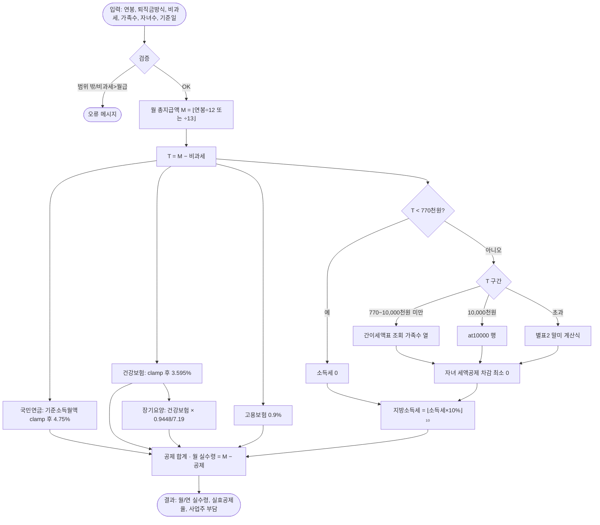
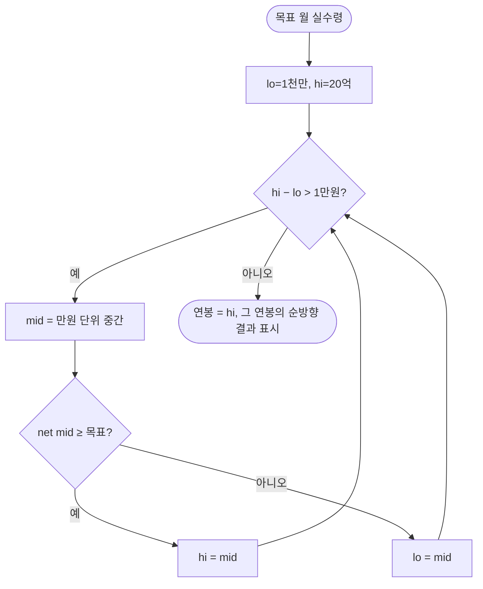
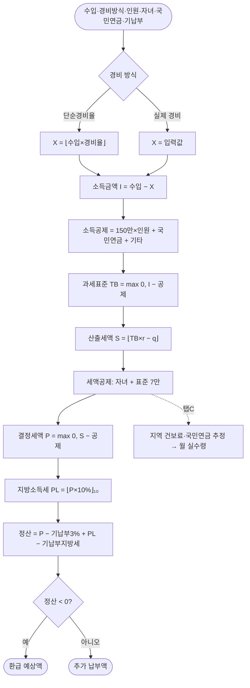
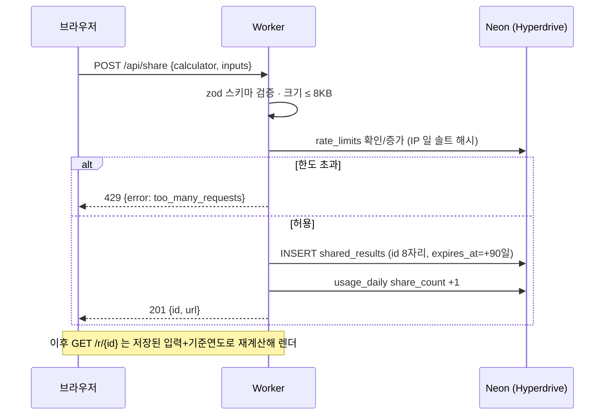
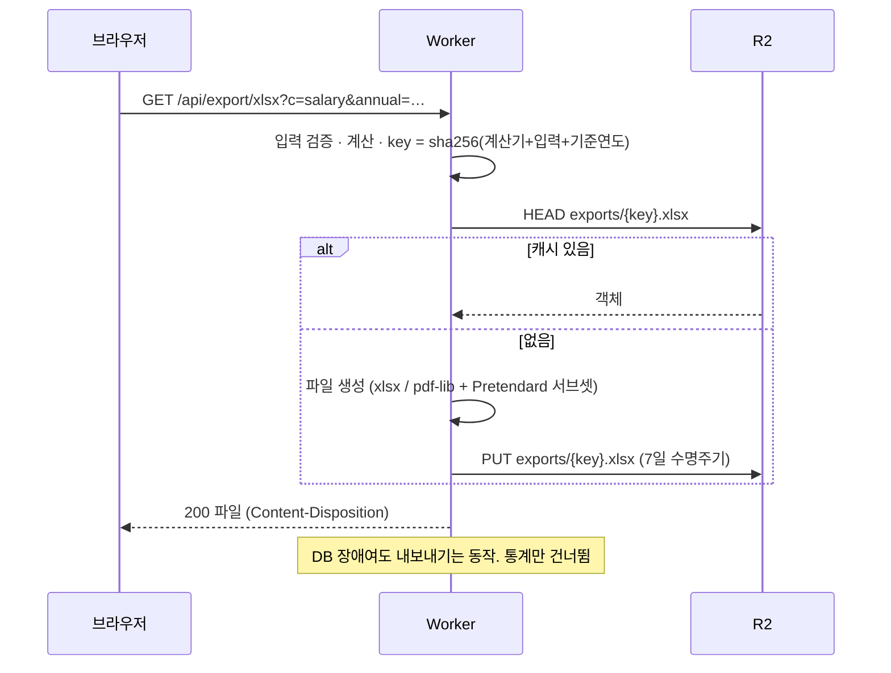
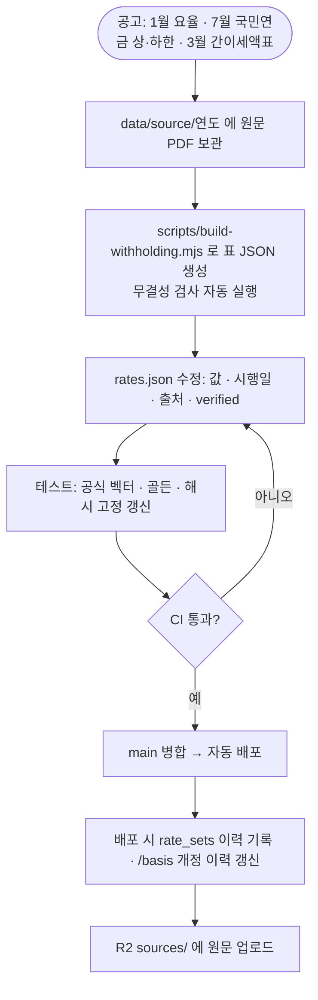

# 플로우차트

> Mermaid 문법(GitHub에서 바로 렌더링). 계산 로직 상세는 [FORMULAS.md](FORMULAS.md).

## 1. 사용자 흐름 (전체)

```mermaid
flowchart TD
  A([방문: 검색·대문 카드·링크]) --> B{진입 경로}
  B -->|홈 /| C[계산기 4종 중 선택]
  B -->|검색 /salary/table/4000| D[연봉별 실수령액표]
  B -->|공유 링크 /r/id| E[읽기 전용 결과]
  D -->|이 연봉으로 계산| F
  C --> F[계산기 화면: 입력 폼]
  F --> G{입력 유효?}
  G -->|아니오| H[필드 오류 표시<br/>결과 유지/숨김]
  H --> F
  G -->|예| I[즉시 계산 · 300ms 디바운스]
  I --> J[결과: 실수령·공제표·근거]
  J --> K{다음 행동}
  K -->|입력 수정| F
  K -->|링크 만들기| L[POST /api/share]
  K -->|엑셀·PDF| M[GET /api/export]
  K -->|주소 복사| N[쿼리스트링 URL 복사]
  K -->|다른 계산기| C
  K -->|값이 다르다| O[/feedback 신고]
  L --> P[짧은 링크 표시 · 복사]
  E -->|이 입력으로 다시 계산| F
```

## 2. 연봉 계산기 로직



## 3. 역산 (희망 월 실수령 → 연봉)



## 4. 프리랜서 5월 정산 로직



## 5. 공유 링크 생성 (시퀀스)



## 6. 엑셀·PDF 내려받기 (R2 캐시)



## 7. 요율 갱신 (운영 절차, 연 2회)



## 8. 예외·오류 처리 표

| 상황 | 감지 | 사용자 화면 | 서버 처리 |
|---|---|---|---|
| 숫자 아님/음수 | 클라이언트·서버 둘 다 | 필드 아래 붉은 문구, 결과 영역 유지 | 400 + fields |
| 연봉 범위 밖(<1천만·>20억) | 검증 | "1,000만원~20억원 사이로 입력" | 400 |
| 비과세 > 월 급여 | 검증 | "비과세액이 월 급여보다 큽니다" | 400 |
| 가족 수 < 1 또는 자녀 > 가족−1 | 검증 | 자동 보정 + 안내문 | 보정된 값으로 계산, 응답에 `adjusted` 표기 |
| 월 과세급여 < 770천원 | 계산 | "소득세 0원 구간" 배지 | 정상 |
| 국민연금 상·하한 적용 | 계산 | "상한(하한) 적용" 배지 | 정상 |
| DB 연결 실패 | 공유/통계 호출 | 공유 버튼 비활성 + "잠시 후 다시" | 계산·내보내기는 정상, 오류 로그(입력 미기록) |
| R2 실패 | 내보내기 | "파일을 만들지 못했어요. 다시 시도" | 500, 캐시 건너뛰고 직접 생성 시도 |
| 공유 ID 없음/만료 | `/r/{id}` | 404 안내 + 계산기 이동 버튼 | 404 |
| 속도 제한 | 공유·신고 | "잠시 뒤에 다시 시도해 주세요" | 429 + Retry-After |
| JS 비활성/실패 | — | 폼 제출(GET)로 서버 렌더 결과 | 같은 코어로 계산 |
