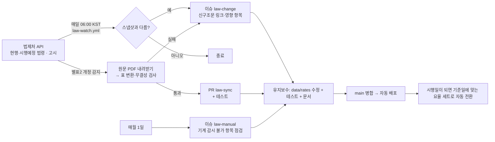

# 법령 변경 대응 체계

> 목표: **법이 바뀌면 계산도 바뀐다.** 변경을 놓치지 않고(감시), 시행일에 맞춰 자동 전환되고(데이터 구조), 근거를 화면에 공개한다(투명성).

## 1. 전체 구조

| 층 | 무엇을 | 어떻게 | 위치 |
|---|---|---|---|
| ① 시행일 기반 데이터 | 요율·한도·세율을 연도(세트)별로 시행일과 함께 보관. 기준일(오늘)에 맞는 세트를 고른다 | `data/rates/<연도>/rates.json` + `src/core/rates.ts` | 코드 수정 없이 데이터만 바꿔도 계산·화면 문구가 함께 바뀜 (UT-H1 가드) |
| ② 변경 감시 | 계산에 쓰는 법령 20개·고시 4종의 **현행·시행예정** 목록을 스냅샷과 비교 | `scripts/law-watch.ts`, `data/watch/` | Actions 매일 |
| ③ 간이세액표 자동 갱신 | 시행령 별표2 개정일이 새로우면 원문 PDF → 표 JSON → PR | `scripts/sync-withholding.ts` | Actions 매일 |
| ④ 수동 점검 알림 | 법제처 DB에 없는 것(장기요양보험료율·경비율 등)을 해당 달에 알림 | `scripts/law-manual.ts` | Actions 매월 1일 |
| ⑤ 화면 공개 | `/basis` 에 확정·미확정·시행예정 개정, 마지막 확인일 | `src/server/basis.ts` | 배포 시 스냅샷 반영 |
| ⑥ 유지보수 루틴 | 이슈를 읽고 데이터·테스트·문서를 고쳐 PR→병합 | Claude 예약 루틴(아래 §5) | 매일 |

## 2. 시행일에 자동 전환되는 원리
- `resolveRates(기준일)` = 시행일(`effectiveFrom`)이 기준일 이전인 세트 중 **가장 늦은 것**.
- 2026 세트(확정) → 2027 세트(일부 잠정, `extends: 2026`)는 확정된 값만 `overrides` 로 바꾸고 나머지는 앞 연도 값을 물려받는다. **2027-01-01 이 되면 코드 변경 없이 2027 세트로 계산**하고, 확정 전 항목은 결과 위에 "잠정" 안내를 붙인다.
- 연중 변경(국민연금 상·하한 7/1)은 `nps.limits[].from` 으로, 간이세액표 시행일은 `withholding.json.effectiveFrom` 으로 관리한다.
- 새 연도 추가: `data/rates/<새 연도>/rates.json`(`extends` + `overrides`, `confirmed`/`pending`) 를 만들고 `npm run build:registry` — 코드 수정 없음.

## 3. 변경 이슈 처리 절차 (law-change)
1. 이슈의 **영향 항목**과 신구조문대비 링크로 무엇이 바뀌었는지 읽는다. 시행일이 **미래**인지 **이미 시행**인지 구분한다.
2. 영향 매핑으로 바꿀 값을 찾는다.

   | 법령·고시 | 바뀔 수 있는 값 (`rates.json`) |
   |---|---|
   | 소득세법·시행령 | `incomeTax.*`(세율·공제·자녀공제), `freelancer.withholdingIncome/Local`(원천징수세율), `taxFree.*`, 간이세액표(별표2) |
   | 지방세법 | `incomeTax.localTaxRatio`, `freelancer.withholdingLocal` |
   | 국민연금법·시행령·고시 | `nps.rate`(매년 +0.5%p), `nps.limits`(7/1 상·하한) |
   | 국민건강보험법·시행령·고시 | `nhis.rate`, `nhis.premiumMin/Max`, `nhis.regionalScoreUnitPrice` |
   | 노인장기요양보험법·시행령 | `nhis.ltc.rate` |
   | 고용보험법·시행령 | `ei.workerRate/employerRate`, `ei.stabilization` |
   | 고용보험 및 산업재해보상보험의 보험료징수 등에 관한 법률 시행령 | `freelancer.employmentInsurance.rate/workerShare` (예술인 제56조의5·노무제공자 제56조의6: 1천분의 16, 본인 ½). 일반 근로자 요율(`ei.*`, 제12조 실업급여 1천분의 18)과 별개 |
   | 산재보험 법령·고시 | `wci.defaultRate` |
   | 최저임금법·고시 | `labor.minHourlyWage`, `labor.monthlyPaidHours` |
   | 근로기준법·시행령 | `labor.*Premium` |
3. 값은 **법령·정부 원문**(법제처 API/PDF, 공단·부처 공고)에서만 가져온다. 블로그·언론은 "무엇이 바뀌는지" 찾는 용도로만 쓰고 값은 원문으로 확인한다. 확인하지 못하면 `verified:false` + `/basis` 미확정 목록에 올린다.
4. 해당 세트의 `rates.json` 에 반영한다. 미래 시행이면 그 연도 세트의 `overrides` 로, 이미 시행이면 현재 세트를 고친다. 확정되면 `pending` 에서 `confirmed` 로 옮긴다.
5. `docs/FORMULAS.md` 의 표·예시와 테스트 기대값(공식 벡터, `UT-R*`)을 새 값으로 고치고 `npm test`, `npm run test:db`, `npm run test:e2e` 를 통과시킨다.
6. `npm run law:update` 로 스냅샷을 갱신해 함께 커밋한다 (이후 같은 변경은 다시 알리지 않는다).
7. PR → 병합 → 자동 배포 → `/basis` 개정 이력과 `/api/health` 확인 → 이슈 닫기.

## 4. 알려진 시행 예정 (2026-10-11 기준, 스냅샷에서 자동 추출)
- 소득세법: 2027-01-01(여러 건), 2027-09-09, 2028-01-01 시행 예정 개정 — 2027 세제 관련. **내용 확인 후 반영 필요**
- 소득세법 시행령: 2026-10-01 시행(현행), 2027-01-01(여러 건), 2028-01-01
- 국민연금법: 2027-01-01 · 2027-03-16 · 2028-01-01 / 건강보험법·시행령: 2026-12-24 · 2027-01-01 / 고용보험법: 2026-11-27 · 2027-01-01 · 2028-01-01 / 최저임금법 2026-12-08
- 2027 확정: 국민연금 보험료율 10.0%, 건강보험료율 7.19% 동결, 최저임금 10,700원 → `data/rates/2027/rates.json`
- **미확정(추적 중)**: 프리랜서 원천징수 3%→2%(2026 세제개편안, 현행 법조문은 100분의 3), 장기요양보험료율, 고용보험료율 인상, 2027 간이세액표, 건보료 상·하한

## 5. 유지보수 루틴 (자동)
Claude 예약 루틴(매일 07:12 KST, 새 세션으로 실행)이 `law-change`·`law-sync`·`law-manual` 이슈/PR 과 2027 세트의 확정 전 항목을 확인한다.
- 이슈가 있으면 §3 의 절차대로 데이터·테스트·문서를 수정해 PR 을 만들고, CI 가 통과하면 병합한다.
- **매년 10~11월**에는 열린 `law-manual` 이슈의 장기요양보험료율(장기요양위원회)·건강보험료율(건강보험정책심의위원회)·부과점수당 금액을 보건복지부 보도자료·공고, 공단 공지 원문에서 찾는다. 정부 기관이 직접 낸 원문이면 확정 근거로 쓰고(다음 해 세트 `overrides`), 언론 보도만 있으면 확정하지 않는다. 의결 전이면 이슈를 열어 두고, 달라진 것이 있을 때만 댓글을 남긴다.
- 값을 원문으로 확정할 수 없으면(예: 공고 전) 반영하지 않고 이슈에 이유를 남긴다.
- 루틴이 처리하지 못한 이슈는 열린 채로 남아 사람이 볼 수 있다.

## 5.1 실제 법제처 응답에서 확인한 것 (2026-10-11)
간이세액표 자동 갱신은 처음에 가짜 XML 로만 시험해, 실제 응답에서 "별표2를 찾지 못했어요"로 실패했다(QA-PLAN D-09). 실제 구조:
- 시행령 본문: `lawService.do?target=law&ID=003956&type=XML` (약 3MB). 이 환경·러너에서 큰 응답은 가끔 끊기므로 재시도한다(`curl --retry-all-errors` 또는 스크립트의 재시도).
- 별표는 `<별표단위>` 안에 있고 **제목에 `[별표 2]`·개정일이 없다.** 근로소득 간이세액표는 `<별표번호>0002` + `<별표제목>근로소득 간이세액표(제189조제1항 관련)`. 연금소득(제189조제2항)·종교인소득(제202조제4항) 간이세액표가 같은 법에 따로 있으므로 제목으로 구분한다.
- **개정일은 `<별표내용>` 첫 줄**(`■ 소득세법 시행령 [별표 2] <개정 2026. 2. 27.>`), PDF 는 `<별표서식PDF파일링크>`(`/LSW/flDownload.do?flSeq=…`). 법제처가 PDF 를 다시 만들어 flSeq·파일 해시가 바뀌어도 내용이 같으면 표는 같다 → **개정일로만 비교**한다.
- 검증: 이 PDF 를 `pdftotext -layout` → `build-withholding` 하면 저장된 표와 구간 646개·10,000천원 행·초과 구간 식·자녀 세액공제가 모두 같다.
- 새 외부 응답을 파싱하는 코드를 추가하면 가짜 데이터 시험만으로 끝내지 말고, 실제 응답으로 한 번 돌려 본 뒤(수동 실행 `법령 변경 감시` → Run workflow) 병합한다.

## 6. 운영 설정
- 저장소 맨 위 탭 **Settings**(Actions 탭이 아님) → 왼쪽 Code and automation → Actions → General → 맨 아래 Workflow permissions → **"Allow GitHub Actions to create and approve pull requests"** 체크 후 Save (간이세액표 자동 PR 용; 없으면 이슈로 대체 알림). 설정 완료(2026-10-11).
- (선택) Secrets `LAW_OC`: 법제처 OPEN API 인증키 발급(<https://open.law.go.kr>) — 없으면 공용 키로 동작하며, 차단되면 조회 실패 경고가 뜬다.
- 감시 대상 추가/삭제: `data/watch/targets.json` → `npm run law:update`.
