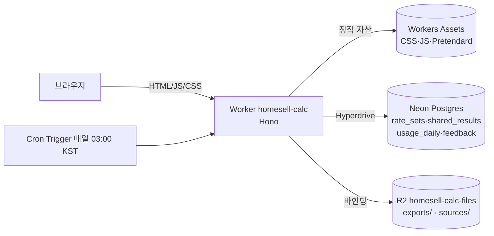

# homesell 계산기 기획서

> 상태: v1.0 · 작성일: 2026-10-10 · 기준연도: 2026
> 관련 문서: [계산식](FORMULAS.md) · [플로우차트](FLOWS.md) · [디자인](DESIGN.md) · [QA 계획](QA-PLAN.md) · [배포](DEPLOY.md)

---

## 1. 개요

### 1.1 한 줄 정의
연봉·월급·4대보험·프리랜서 소득을 **공식 기준(국세청 간이세액표, 4대보험 공단 요율)과 같은 값으로** 계산해 주는 무료 계산기 사이트.

### 1.2 배경과 위치
- 대문 사이트(`www.homesell.co.kr`)의 연봉·급여·4대보험·프리랜서 카드 4개가 이 사이트로 연결된다 (2026-10-11 연결 완료). 이 사이트가 그 카드의 도착지다.
- 주소: **`https://calc.homesell.co.kr`** (별도 Worker `homesell-calc`). 가계부(`account.homesell.co.kr`)와 DB·R2·계정을 공유하지 않는다 (가계부는 개인 금융 데이터라 완전히 분리).

### 1.3 차별점 (기존 계산기와 다른 점)
| 문제 (기존 계산기) | 이 사이트 |
|---|---|
| 소득세를 "대략식"으로 계산해 간이세액표와 어긋남 | **국세청 간이세액표 원문(646개 구간)을 그대로 조회** — 월 원천징수액과 같은 값 |
| 요율·상·하한 기준일이 불분명 (7/1 국민연금 상한 변경 등) | 기준일(날짜)별 요율표. 화면에 **적용 기준일·근거 링크** 표시 |
| 블로그 수치끼리 충돌 (장기요양 12.95%/13.14% 등) | 법령·공단 원문과 대조한 값만 사용. 확인 못 한 값은 "가정"으로 표시 |
| 결과를 남기거나 보내기 불편 | 짧은 **공유 링크**, **엑셀·PDF 명세서** 내려받기 |

### 1.4 목표 / 비목표
**목표**
- G1. 5개 계산기(연봉·급여·4대보험·프리랜서·연말정산)를 로그인 없이 5초 안에 결과까지.
- G2. 결과가 공단 모의계산·간이세액표와 **±10원 이내**(단수처리 차이)로 일치.
- G3. 검색 유입: 연봉별 실수령액표 등 정적 SEO 페이지.
- G4. 요율 변경(매년 1월, 7월)을 **코드 배포 없이 데이터만** 바꿔 반영할 수 있는 구조.

**비목표 (v1 범위 밖)**
- 연말정산(환급액) 계산, 퇴직소득세, 양도·상속·증여 등 다른 세목
- 일용직·외국인 근로자(분리과세 19%·단일세율) — 안내 문구만
- 회원가입·로그인, 계산 이력 계정 저장
- 세무 상담/신고 대행 (면책 고지를 둔다)

---

## 2. 사용자와 시나리오

| 페르소나 | 상황 | 쓰는 계산기 |
|---|---|---|
| 취준생/이직자 (28세) | 제시받은 연봉 4,200만원의 월 실수령이 궁금 | 연봉 |
| 신입 사원 | 월급명세서의 공제 항목이 맞는지 확인 | 급여 |
| 인사·총무 담당 | 직원 채용 시 회사 부담 4대보험 산정 | 4대보험 |
| 프리랜서 (디자이너) | 외주 단가에서 3.3%를 떼면? 5월 종소세와 지역 건보료는? | 프리랜서 |
| 소상공인 사장 | 시급제 직원 월급·주휴수당·최저임금 확인 | 급여 |

핵심 시나리오 흐름은 [FLOWS.md](FLOWS.md) 참조.

---

## 3. 정보구조 (IA)

```
/                         홈 (계산기 5종 카드, 기준연도·기준일 배지)
├─ /salary                연봉 계산기 (연봉 → 월 실수령, 역산 지원)
│   └─ /salary/table      연봉별 실수령액표 (SEO 인덱스)
│       └─ /salary/table/{만원}   예) /salary/table/4000  — 정적 생성
├─ /payroll               급여 계산기 (월급명세서·시급·수당·최저임금)
├─ /insurance             4대보험 계산기 (근로자/사업주 부담)
├─ /freelancer            프리랜서 계산기 (3.3%, 5월 종소세, 지역 건보료)
├─ /yearend               연말정산 계산기 (내 환급 예측 / 부부 중 누가 공제받을까)
├─ /r/{id}                공유 결과 (읽기 전용 + 같은 입력으로 다시 계산)
├─ /basis                 계산 기준 (요율표·공식·출처·미확정 항목)
├─ /feedback              오류·불일치 신고
├─ /sitemap.xml, /robots.txt
└─ /api/*                 아래 §7
```

- 상단 내비게이션: 로고(홈) · 연봉 · 급여 · 4대보험 · 프리랜서 · 연말정산 · 계산 기준.
- 모든 계산기 하단: 결과 설명(어떻게 계산했나), 면책 고지. 다른 계산기로 가는 길은 상단 내비게이션(모바일은 하단 탭바)만 둔다 — 같은 링크 묶음을 하단에 또 두지 않는다 (연봉 페이지만 "연봉별 실수령액표" 링크 한 줄).

---

## 4. 기능 명세

공통: 모든 입력은 **금액 입력 시 천 단위 콤마 자동 표시**, 숫자만 허용, 음수·소수 불가(시급·요율 제외). 입력 변경 후 300ms 디바운스로 **즉시 재계산**(JS 없으면 폼 제출로 같은 결과). 입력값은 URL 쿼리에 반영되어 **주소 복사만으로 공유 가능**(서버 저장 없음).

### 4.1 연봉 계산기 `/salary`

| 구분 | 필드 | 타입/기본값/범위 | 검증·비고 |
|---|---|---|---|
| 입력 | 계산 방향 | 라디오: 연봉→실수령(기본) / 희망 월 실수령→필요 연봉 | 역산은 이분 탐색(§FORMULAS 7) |
| | 연봉(세전) | 원, 기본 40,000,000, 1,000만~20억 | 범위 밖 → 경고 후 보정 안 함 |
| | 퇴직금 | 라디오: 별도(기본) / 연봉에 포함(연봉÷13) | 포함 시 월 지급액 = 연봉÷13 |
| | 월 비과세액 | 원, 기본 200,000(식대) | 0~월 급여. 식대 한도 20만원 초과 시 경고 |
| | 부양가족 수(본인 포함) | 1~20, 기본 1 | 11명 초과는 별표2 4호 계산식 |
| | 8세 이상 20세 이하 자녀 수 | 0~10, 기본 0 | 부양가족 수에 포함된 값이어야 함 → 자녀 > 가족−1 이면 보정 안내 |
| 출력 | 월 실수령액 (강조) | | |
| | 공제 내역표 | 국민연금·건강보험·장기요양·고용보험·소득세·지방소득세 + 합계 | 각 항목 근거(요율) 툴팁 |
| | 월 총액/과세 급여 | | |
| | 연 환산 실수령액, 실효 공제율(%) | | |
| | 사업주 부담(옵션 토글) | 4대보험 사업주분 | 인건비 총액 파악용 |
| 동작 | 결과 공유 | "링크 만들기" → `/r/{id}` | §5.3 |
| | 내려받기 | 엑셀 / PDF | R2, §6.2 |
| 예외 | 월 과세급여 770천원 미만 | 소득세 0원 안내 | 간이세액표 시작 구간 |
| | 월 과세급여 10,000천원 초과 | 별표2 말미 계산식 적용 | |
| | 비과세 > 월 급여 | 오류 메시지, 계산 보류 | |

### 4.2 급여 계산기 `/payroll`
월급명세서를 만드는 계산기. 탭 2개.

**탭 A. 월급제**
| 필드 | 설명 |
|---|---|
| 기본급 | 월 고정 기본급(과세) |
| 고정수당 목록 | 이름·금액·비과세 여부 반복 입력 (최대 10개). 식대 비과세 20만원 프리셋 |
| 연장·야간·휴일 근로시간 | 월 합계 시간 3칸. 통상시급 = (기본급+통상 포함 수당)÷209, 가산율 50%(휴일 8시간 초과 100%) |
| 상여(이번 달) | 과세, 소득세는 간이세액표 월급여에 합산 |
| 부양가족·자녀 수 | 연봉 계산기와 동일 |
| 출력 | 지급 합계 → 공제 → 차인지급액, 항목별 명세서(엑셀·PDF) |

**탭 B. 시급제 (아르바이트·계약직)**
| 필드 | 설명 |
|---|---|
| 시급 | 기본 10,320(2026 최저임금) — 미만 입력 시 경고 |
| 주 소정근로시간 | 기본 40 (주 15시간 이상이면 주휴수당 발생) |
| 월 환산 | 주휴 포함 월 환산시간 = 주 근로시간(+주휴)×(365÷7÷12), 40h/주 → 209h |
| 공제 방식 | 라디오: 4대보험+세금 / 공제 없음. 3.3% 원천징수는 프리랜서 계산기 몫이라 두지 않는다 (옛 링크의 `deduction=tax33` 은 4대보험+세금으로 열림) |
| 출력 | 주휴수당, 월급 총액, 공제, 실수령, 최저임금 충족 여부(월 환산 기준) |

### 4.3 4대보험 계산기 `/insurance`
| 구분 | 필드 | 비고 |
|---|---|---|
| 입력 | 월 보수(과세 기준) | 비과세 제외 금액. 안내 문구로 명시 |
| | 기준일 | 기본 오늘. 국민연금 상·하한이 7/1에 바뀌므로 날짜 선택 가능(2026-01-01~2026-12-31) |
| | 사업장 규모 | 4구간(고용안정·직능개발 요율) |
| | 산재보험료율(‰ 또는 %) | 기본 1.47%, 사업주가 직접 변경 |
| 출력 | 4대보험 표 | 보험별 보험료 총액·근로자 부담·사업주 부담. 합계. 연 환산 |
| | 상·하한 적용 표시 | "기준소득월액 상한 6,590,000원 적용" 등 배지 |
| | 두루누리 안내 | 10인 미만·월 소득 260만 미만 신규가입자 80% 지원 → **안내 링크만**(v1 계산 제외) |

### 4.4 프리랜서 계산기 `/freelancer`
탭 3개.

**탭 A. 3.3% 원천징수** — 세전 ↔ 실수령 양방향
- 입력: 금액(세전 또는 실수령 선택), 단위(건당/월), 개월 수(연 환산용)
- 선택 입력 **고용보험 공제율(%)**: 예술인·노무제공자(특고) 고용보험이 적용되어 지급처가 세전 금액에서 함께 뗄 때 쓴다. 기본 0(공제 안 함). 법정 본인 부담은 고용보험료율 1.6%의 절반인 **0.8%**(일반 근로자 0.9%와 다름)이며, 지급처가 다른 율을 떼면 정산서의 값을 그대로 입력한다. 식: `실수령 = 세전 − 3.3% − 세전×공제율` ([FORMULAS §6.1](FORMULAS.md)).
- 출력: 소득세 3%, 지방소득세 0.3%, (입력 시) 고용보험, 실수령, 연 환산. "소액부징수: 소득세 1,000원 미만이면 징수 없음" 안내(세전 33,333원 미만).

**탭 B. 5월 종합소득세 정산 시뮬레이션**
| 필드 | 설명 |
|---|---|
| 연 수입금액 | 3.3% 떼기 전 총수입 |
| 경비 방식 | 단순경비율(기본, 비율 직접 입력, 기본 64.1% — 업종별로 다름 경고) / 실제 경비 직접 입력 |
| 부양가족 수(본인 포함), 자녀 수 | |
| 납부한 국민연금(연) | 소득공제. "지역 국민연금 추정액 사용" 토글 |
| 기납부세액 | 자동: 수입×3% (직접 수정 가능) |
| 출력 | 소득금액 → 과세표준 → 산출세액 → 결정세액 → 지방소득세 → **환급/추가납부액** 단계표 |
| v1 제외 | 기준경비율(주요경비 증빙) 방식, 복식부기, 노란우산공제 등 개별 공제 — 안내문 |

**탭 C. 월 실수령 종합 (세후 + 지역 건보료·국민연금)**
- 입력: 월 평균 수입(탭 B와 연동), 재산 보험료 부과점수(선택, 직접 입력)
- 출력: 월 지역 건강보험료(+장기요양), 지역 국민연금, 월 세금(종소세 월환산), **월 실수령 추정**.
- 안내: 건보료는 5월 신고 후 11월부터 변경 부과 / 가입 자격에 따라 달라질 수 있음.

### 4.5 연말정산 계산기 `/yearend`
**목적**: 4대보험을 내는 정규직이 연말정산에서 얼마를 돌려받는지(또는 더 내는지) 미리 보고, 부부 중 누가 공제받아야 유리한지 비교한다. 식·근거는 [FORMULAS §10](FORMULAS.md).

탭 2개.
**탭 A. 내 연말정산 예측**
| 구분 | 입력 |
|---|---|
| 기본 | 귀속연도(1~2월에 열면 직전 연도), 연 총급여, 비과세 |
| 카드 등 | 신용카드·체크/현금영수증·전통시장·대중교통·문화체육 |
| 본인 지출 | 의료비·교육비·보장성 보험료·기부금(특례/일반/종교/고향사랑) |
| 연금·주택 | 연금저축·IRP, 주택청약, 월세, 무주택 세대주, 출산·입양 |
| 부양가족(≤6) | 관계(배우자·자녀·부모), 출생연도, 소득요건, 가족별 의료비·교육비·보험료·카드 |
| 고급(선택) | 4대보험 연간액, 이미 낸 소득세, 원천징수 신고 가족 수 — 비우면 추정(U12·U13) |
| 출력 | 환급/추가납부 큰 숫자, 단계표(총급여 → 결정세액 → 정산액), "이렇게 하면 더 받아요" 절세 팁, 미반영 항목 |

**탭 B. 부부 중 누가 공제받을까** — 부부 각자의 입력 + 부양가족 + 공동 카드 지출. 모든 배분을 직접 계산해 세금 합계가 가장 낮은 안(부양가족별 담당, 공동 카드를 누구 카드로 쓸지)을 추천하고, 가족별 "반대로 하면 +얼마"와 "모두 한쪽에 몰면" 비교표를 보여 준다.

**범위 밖**: 주택자금 이자 공제·장애인·한부모·정치자금·이월 기부금·중도입퇴사·다중 근로·결혼세액공제 (화면에 "반영하지 않는 항목"으로 명시). 결과는 모의 계산이며 공제 대상·증빙은 국세청 연말정산 간소화 자료가 기준.

---

## 5. 공통 정책

### 5.1 면책·표시
- 모든 결과 상단에 "**2026년 기준 · 모의 계산**" 배지, 하단에 "실제 금액은 사업장·공단 고지와 다를 수 있음" 면책 고지.
- 결과 항목마다 "계산 근거" 링크 → `/basis#…`.

### 5.2 기준연도·기준일 정책
- 요율은 `rate_sets(year, effective_from)` 기준일 버전. 계산 시 **기준일을 받아** 해당 버전을 선택(국민연금 7/1 상·하한 같은 연중 변경 지원).
- 2027년 요율은 공식 확정 전(간이세액표 미개정, 장기요양·고용보험료율 미확정)이라 **게시하지 않는다.** 확정되면 데이터 파일 추가만으로 반영(§6.3).

### 5.3 공유 링크
- 사용자가 "링크 만들기"를 누를 때만 입력값(JSON, 개인 식별정보 없음)을 DB에 저장하고 8자리 ID 발급.
- 결과는 저장하지 않고, 열 때 **저장된 입력 + 저장 당시 기준연도**로 재계산(기준 고정). 만료 90일(Cron으로 삭제).
- 입력 크기 제한 8KB, 허용 필드 스키마(zod) 검증, IP 해시 기반 분당 10건 제한.

### 5.4 개인정보
- 계정·쿠키 없음. 분석은 서버 집계 카운터(계산기별 일별 호출 수)만 저장. IP는 저장하지 않고 일 단위 솔트 해시를 제한 계산에만 사용(24시간 후 삭제).
- 피드백의 연락처는 선택 입력, 90일 후 삭제.

---

## 6. 시스템 구성

### 6.1 아키텍처

- **Worker**: 서버 렌더링(SEO) + 계산 API. 계산 코어(`src/core`)는 서버·브라우저가 **같은 코드**를 쓴다(결과 불일치 방지).
- **Neon + Hyperdrive**: 공유 링크·통계·요율 이력·피드백. **계산은 DB 없이 동작**한다(요율 번들 내장) → DB 장애 시에도 계산기는 정상, 공유/통계만 비활성.
- **R2**: ① 내려받기 파일(xlsx/pdf) 캐시 `exports/{입력해시}.{ext}`(7일 수명주기 규칙) ② 근거 원문 보관 `sources/{연도}/…`(간이세액표 PDF 등, `/basis`에서 링크).
- 배치: 가계부 때 확인한 대로 DB 왕복이 곧 지연이므로 Worker는 Neon(`aws-ap-southeast-1`) 가까이에서 실행(`placement`), 화면당 DB 쿼리 ≤ 2회(`Promise.all`).

### 6.2 기술 스택
| 영역 | 선택 | 이유 |
|---|---|---|
| 런타임 | Cloudflare Workers + Workers Assets | 기존 운영 방식 |
| 서버 프레임워크 | Hono (JSX 없이 문자열 템플릿) | 번들 작음, JSP 같은 서버 렌더링 모델, Next.js 대비 배포 용량·빌드 위험 낮음 |
| 언어 | TypeScript (strict) | 계산 코어 타입 안정성 |
| 클라이언트 | 바닐라 TS(진행적 향상) + esbuild | 프레임워크 없이 폼·결과 갱신 |
| DB | Neon Postgres, `postgres`(postgres.js) via Hyperdrive | 기존 방식 (`fetch_types:false`, 요청마다 연결) |
| 파일 | R2 (`RATE_FILES` 바인딩) | |
| 엑셀 | `write-excel-file` (universal) | 가계부에서 검증된 라이브러리 |
| PDF | `pdf-lib` + `@pdf-lib/fontkit` + Pretendard 서브셋 | Worker 안에서 한글 PDF 생성 |
| 테스트 | Vitest(단위·골든), Playwright(e2e), 임시 Postgres(`scripts/test-db.sh`) | 가계부와 동일 패턴 |
| 폰트 | Pretendard **다이나믹 서브셋** (자체 호스팅 woff2) | 요청사항 |

### 6.3 요율 데이터 운영
- 원천: `data/rates/{연도}/rates.json` + `withholding.json` (git 관리, 근거 id·URL·검증 여부 포함).
- 빌드: 번들에 내장 → 계산은 외부 의존 없음.
- 배포 시 `rate_sets` 테이블에 **버전 기록**(연도·시행일·SHA-256·메모) → `/basis`의 "개정 이력" 표시.
- 연 2회(1월·7월) 갱신 절차는 [DEPLOY.md](DEPLOY.md) "요율 갱신".

---

## 7. 데이터 모델 (Neon)

```sql
-- 요율 버전 이력 (계산은 번들 사용, 이 표는 이력·감사용)
rate_sets(id serial pk, year int, version text, effective_from date, sha256 text, note text, created_at timestamptz default now(), unique(year, version))

-- 공유 결과
shared_results(id text pk /*8자리 base62*/, calculator text check in ('salary','payroll','insurance','freelancer','yearend'),
               rate_year int not null, inputs jsonb not null, created_at timestamptz default now(), expires_at timestamptz not null)
  index(expires_at)

-- 사용 통계 (익명 집계)
usage_daily(day date, calculator text, calc_count int default 0, share_count int default 0, export_count int default 0, primary key(day, calculator))

-- 오류·불일치 신고
feedback(id serial pk, calculator text, message text not null check (length(message) <= 2000),
         contact text, page_url text, created_at timestamptz default now(), expires_at timestamptz)

-- 남용 제한 (IP 해시, 24h 후 삭제)
rate_limits(key text, window_start timestamptz, hits int, primary key(key, window_start))
```
마이그레이션은 `migrations/*.sql`, 배포 시 자동 적용(가계부 `scripts/migrate.mjs` 방식).

R2 키: `exports/{sha256(inputs+year)}.xlsx|pdf`, `sources/2026/income-tax-decree-annex2-2026-02-27.pdf`.

## 8. API 명세 (요약)

| 메서드 경로 | 설명 | 응답 |
|---|---|---|
| `GET /api/health` | 상태 (DB 연결·R2·기준연도) — 가계부와 같은 형식 | JSON |
| `GET /api/calc/{salary\|payroll\|insurance\|freelancer}?…` | 쿼리 입력 → 계산 결과 JSON (서버·클라이언트 검증용) | JSON |
| `POST /api/share` | `{calculator, inputs}` → `{id, url}` | 201 / 400 / 429 |
| `GET /api/export/{xlsx\|pdf}?c=…&…` | 파일 생성 후 R2 캐시, 302 또는 스트림 | 파일 |
| `POST /api/feedback` | 신고 접수 | 204 / 400 / 429 |
| `GET /r/{id}` | 공유 결과 페이지 | HTML |

오류 응답 형식: `{ "error": "코드", "message": "한국어 설명", "fields": {"annual": "…"} }`.

## 9. 비기능 요구사항

| 항목 | 기준 |
|---|---|
| 성능 | 서버 렌더링 TTFB p75 ≤ 300ms(국내), JS 번들 gzip ≤ 60KB, LCP ≤ 2.0s(모바일 4G) |
| 정확도 | 간이세액표 조회값 100% 일치. 4대보험은 공단 모의계산 예시 ±10원 |
| SEO | 계산기별 고유 title/description/canonical, 연봉표 정적 페이지, `sitemap.xml`, 구조화 데이터(FAQ) |
| 접근성 | WCAG 2.1 AA: 키보드 조작, 라벨, 포커스 링, 대비 4.5:1, `prefers-reduced-motion`, 결과 영역 `aria-live=polite` |
| 보안 | CSP(`default-src 'self'`), 입력 스키마 검증, 공유/신고 속도 제한, 비밀값은 Worker secret |
| 관측 | Workers Observability 사용, `/api/health`, 오류 로그에 입력 원문 미기록 |
| 호환 | 최신 2개 버전 Chrome·Safari(iOS 포함)·Edge·Samsung Internet, 가로 360px부터 |

## 10. 일정과 산출물

| 단계 | 산출물 | 상태 |
|---|---|---|
| 기획 | PLANNING·FORMULAS·FLOWS | 이 문서 |
| 디자인 | DESIGN (토큰·컴포넌트·화면 정의) | |
| 개발 | core → 서버 → UI → DB/R2 → 워크플로 | |
| QA | QA-PLAN(통합 테스트 시나리오) + 자동 테스트 | |
| 마무리 | Pretendard 다이나믹 서브셋 적용, 배포 안내 | |

## 11. 리스크와 결정 사항

| # | 리스크 | 대응 |
|---|---|---|
| R1 | 공식 단수처리 규칙을 문서로 확인하지 못한 항목(국민연금 보험료 10원 단위 등) | `rates.json`에 `verified:false`로 표시, 화면에 "±10원" 안내, 공단 고지서 샘플로 사후 확정 ([FORMULAS §9](FORMULAS.md)) |
| R2 | 2027년 요율 미확정(장기요양·고용보험 2.0% 정부안 등) | 확정 공고 후 데이터 추가. 현재 2026만 게시 |
| R3 | 세법 개정(7월/1월) 누락 | 요율 갱신 체크리스트·`/basis` 개정 이력·테스트의 "공식 표 해시" 고정 |
| R4 | 법적 오해(세무 자문으로 오인) | 면책 고지, "모의 계산" 배지 |
| R5 | 워커 번들 용량(PDF+폰트) | 폰트 서브셋 + PDF 생성 코드는 별도 청크(동적 import), 한도 초과 시 PDF를 인쇄용 HTML로 대체 |

### 결정된 사항 (사용자 확인 2026-10-10)
- 별도 Worker `calc.homesell.co.kr` · 새 저장소 · 새 Neon 프로젝트 · 로그인 없음(공유 링크 + PDF/엑셀)

## 12. 사용자가 해 줘야 하는 연결 (정리)
[DEPLOY.md "처음 한 번"](DEPLOY.md) 참조: ① GitHub 저장소 생성 ② Neon 프로젝트 `homesell-calc` 직접 연결 주소 ③ Cloudflare API 토큰 권한·계정 ID를 새 저장소 Secrets에 ④ Cloudflare DNS·Workers Route(`calc.homesell.co.kr`) ⑤ 대문 카드 연결 PR 승인.
